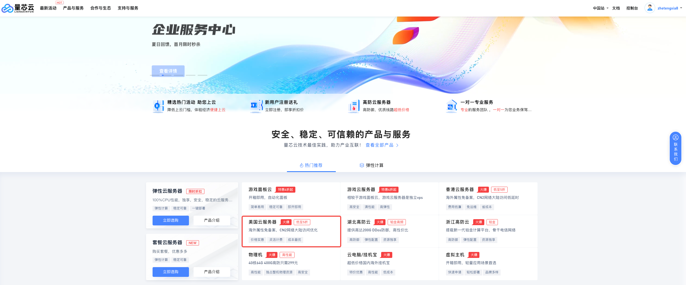

# 2026年11月最新三网优化高性价比 VPS 推荐（附优惠码）

> 【更新】2026.11.13：**🔥 推荐新平台【量芯云】现在美国/香港CN2机器有半价活动，目前最高性价比。**
>
> 【更新】2026.11.06：今年的双十一来了，但是因为VPS近期火爆，各种优惠都没了。甚至低价库存都没了。
>
> 【更新】2026.08.30：搬瓦工质量还是好
>
> 【更新】2026.08.07：【TmhHost 超高性价比还有货】
>
> 【更新】2026.06.27：自己搭建 VPS，[参考: 5 分钟手把手教你把 VPS 搭建成 VPN代理](https://zhetengxia.com/blog/vps-vpn-proxy-setup-2026)
>
> 【更新】2026.06.27：有些朋友不想自己搭 VPS，我补了一篇 [VPN 机场推荐](https://zhetengxia.com/blog/claude-chatgpt-vpn-airport-recommendations-2026)，适合先短周期试用。

只给大家推荐我实际用过和持续关注的 VPS，优先看支持**三网优化**的线路，直接上干货。VPS 的库存、机房、价格和优惠码变化很快，表格适合用来横向比较；下单前请在结算页再次确认配置、续费价格和优惠码是否仍然有效。
> 【三网优化】就是针对国内三路运营商的线路进行了优化，通俗讲就是和你访问国内各类App速度差不多。大多数便宜的VPS通常白天可能问题不大，但是晚上几乎不能用。

## 🔥 量芯云 - 美国CN2，超高性价比，限带宽不限流量

[量芯云](https://prolxy.com/?i3afc66) 是一家国内运营近5年的平台，主打高性价比的轻量云服务器，提供针对中国优化的CN2 高速线路，操作简单，实测质量不错而且稳定，主要是现在所有产品半价，非常适合入手。**务必注意：**

> **购买其云产品必须实名，且所有云产品禁止用于以下业务及服务：色情、博彩、诈骗、钓鱼、黑客、爆破、病毒、外挂、扫描、传奇游戏、网盘、小说、影视、拨号、加速、挖矿、VOIP等违法违规用途。禁止搭建VPN服务、DNS服务、NTP服务、邮件服务、DDOS攻击、加速服务、代刷平台、发卡网、支付平台、挖矿中转以上业务及服务一经发现，立即永久关闭，概不退款。**

|        方案        | 配置          | 流量/月 |           带宽            |                 价格                  |                购买                 |
| :----------------: | ------------- | :-----: | :-----------------------: | :-----------------------------------: | :---------------------------------: |
|  美国CN2 **D区**   | 2C 4G 40G-SSD | 不限量  |  基础20Mbps / 下行50Mbps  | **￥24/月 \￥278/年(满100-10优惠券)** | [购买](https://prolxy.com/?i3afc66) |
|  美国CN2 **D区**   | 4C 4G 40G-SSD | 不限量  |  基础20Mbps / 下行50Mbps  | **￥30/月 \￥330/年(满300-30优惠券)** | [购买](https://prolxy.com/?i3afc66) |
| 美国CN2 **高带宽** | 2C 2G 40G-SSD | 不限量  | 基础50Mbps / 下行100Mbps  | **￥25/月 \￥270/年(满300-30优惠券)** | [购买](https://prolxy.com/?i3afc66) |
| 美国CN2 **高带宽** | 2C 4G 40G-SSD | 不限量  | 基础50Mbps / 下行100Mbps  | **￥30/月 \￥330/年(满300-30优惠券)** | [购买](https://prolxy.com/?i3afc66) |
| 美国CN2 **高带宽** | 4C 4G 40G-SSD | 不限量  | 基础50Mbps / 下行100Mbps  | **￥40/月 \￥450/年(满300-30优惠券)** | [购买](https://prolxy.com/?i3afc66) |
| 美国CN2 **大带宽** | 2C 2G 40G-SSD |   1T    | 基础100Mbps / 下行100Mbps | **￥40/月 \￥450/年(满300-30优惠券)** | [购买](https://prolxy.com/?i3afc66) |
| 美国CN2 **大带宽** | 2C 4G 40G-SSD |   1T    | 基础100Mbps / 下行100Mbps | **￥50/月 \￥540/年(满600-60优惠券)** | [购买](https://prolxy.com/?i3afc66) |
| 美国CN2 **大带宽** | 4C 4G 40G-SSD |   1T    | 基础100Mbps / 下行100Mbps | **￥60/月 \￥660/年(满600-60优惠券)** | [购买](https://prolxy.com/?i3afc66) |

每个方案有更多的配置可选，[打开官网->选择美国/香港云服务器](https://prolxy.com/?i3afc66)。

## 1. BandwagonHost - 知名度最高，线路质量最好，绝不后悔系列

[BandwagonHost](https://bandwagonhost.com/aff.php?aff=81829) 俗称搬瓦工，主打高性价比的海外VPS服务商，提供针对中国优化的CN2 GIA高速线路，操作简单。个人推荐下面两款，其余的年付50$的不建议。

|           方案           | 配置          | 流量/月 |  带宽   |                           推荐机房                           |             价格             |                            购买                            |
| :----------------------: | ------------- | :-----: | :-----: | :----------------------------------------------------------: | :--------------------------: |:----------------------------------------------------------:|
| **CN2 GIA-E** **(推荐)** | 2C 1G 20G-SSD |   1TB   | 2.5Gbps | 美国 DC6 CN2 GIA-E 、美国 DC9 CN2 GIA 、美国圣何塞 CN2 GIA、日本软银 JPOS_1、加拿大 CN2 GIA | **\$49.99/季度 \$169.99/年** | [购买](https://bandwagonhost.com/aff.php?aff=81829&pid=87) 太火了，没货了|
| **CN2 GIA-E** **(贵了)** | 3C 2G 40G-SSD |   2TB   | 2.5Gbps |                             同上                             | **\$89.99/季度 \$299.99/年** | [购买](https://bandwagonhost.com/aff.php?aff=81829&pid=88) |

[点击查看更多方案](https://bandwagonhost.com/aff.php?aff=81829&register=true)

## 2. TmhHost - 高性价比 VPS

> 【更新】11.11：现在年付特惠节点不是CN2 GIA了，换成US 9929了（联通线路）。
这两档的配置、价格和优化线路比较均衡，提供**美国**和**香港**两个节点。点击购买后以官网当前可选方案为准。

|                                方案                                 | 配置          | 流量/月 |  带宽  |    推荐机房    |     价格     |                     购买                     |
|:-------------------------------------------------------------------:| ------------- | :-----: | :----: |:--------------:| :----------: | :------------------------------------------: |
|    **[年付特惠-US 9929](https://www.tmhhost.com/aff/IUEGWOEF)**     | 2C 4G 40G-SSD |   2TB   | 50Mbps | 美国(带美国IP) | **388￥/年** | [购买](https://www.tmhhost.com/aff/IUEGWOEF) |
| **[年付特惠 HK S1 超低延迟](https://www.tmhhost.com/aff/IUEGWOEF)** | 2C 4G 40G-SSD |   2TB   | 10Mbps |      香港      | **388￥/年** | [购买](https://www.tmhhost.com/aff/IUEGWOEF) |

[点击查看更多信息](https://www.tmhhost.com/aff/IUEGWOEF)

## 3. HostDare - CN2 GIA 低价备选（CSSD1 终于有货了）

[HostDare](https://bill.hostdare.com/aff.php?aff=4558) 最新升级到了三网优化，不仅支持CN2 GIA（电信），还支持9929（联通）和CMIN2（移动），一共有 3 大类配置。双11开始有部分库存了，但是优惠码没了。

### 3.1 英特尔芯片 + SSD固态硬盘：

|           方案            | 配置                               |  流量/月  |    带宽    |     推荐机房     |      价格      |                              购买                              | 优惠码 |
|:-------------------------:|------------------------------------|:---------:|:----------:|:----------------:|:--------------:|:--------------------------------------------------------------:|--------|
| ~~CSSD0(这个套餐下架了)~~ | ~~1C 0.76G 10G-SSD（英特尔芯片）~~ | ~~250GB~~ | ~~30Mbps~~ | ~~美国 CN2 GIA~~ | ~~\$32.3/年~~  | ~~[购买](https://bill.hostdare.com/aff.php?aff=4558&pid=112)~~ | ~~无~~ |
|      **CSSD1(推荐)**      | **1C 1G 25G-SSD**（英特尔芯片）    | **500GB** | **50Mbps** | **美国 CN2 GIA** | **\$60.99/年** | **[购买](https://bill.hostdare.com/aff.php?aff=4558&pid=106)** | 无     |
|           CSSD2           | 2C 2G 50G-SSD（英特尔芯片）        |    1TB    |   60Mbps   |   美国 CN2 GIA   |  \$115.99/年   |   [购买](https://bill.hostdare.com/aff.php?aff=4558&pid=107)   | 无     |

### 3.2 AMD芯片+SSD固态硬盘，性能比英特尔的要好一些，但是价格也略贵一些：

|      方案       | 配置                                      |  流量/月  |    带宽    |     推荐机房     | 使用优惠码后的价格 |                              购买                              | 优惠码 |
|:---------------:|-------------------------------------------|:---------:|:----------:|:----------------:|:------------------:|:--------------------------------------------------------------:|--------|
|    ~~CAMD0(这个套餐下架了)~~    | ~~1C 0.76G 10G-SSD（AMD芯片，更强一点）~~ | ~~250GB~~ | ~~30Mbps~~ | ~~美国 CN2 GIA~~ |   ~~\$34.1/年~~    | ~~[购买](https://bill.hostdare.com/aff.php?aff=4558&pid=176)~~ | ~~无~~ |
| **CAMD1(推荐)** | **1C 1G 25G-SSD**，（AMD芯片，更强一点）  | **500GB** | **50Mbps** | **美国 CN2 GIA** |   **\$65.99/年**   | **[购买](https://bill.hostdare.com/aff.php?aff=4558&pid=177)** | 无     |
|      CAMD2      | 2C 2G 50G-SSD，（AMD芯片，更强一点）      |    1TB    |   60Mbps   |   美国 CN2 GIA   |    \$119.99/年     |   [购买](https://bill.hostdare.com/aff.php?aff=4558&pid=178)   | 无     |

### 3.3 机械硬盘，但是搭建VPN的话毫无影响：

|      方案       | 配置                             | 流量/月 |    带宽    |     推荐机房     | 使用优惠码后的价格 |                             购买                             | 优惠码     |
| :-------------: | -------------------------------- |:-------:| :--------: | :--------------: | :----------------: | :----------------------------------------------------------: |------------|
|      CKVM1      | 1C 0.76GB 35G-HDD（机械硬盘）    |  500GB  |   50Mbps   |   美国 CN2 GIA   |     \$44.91/年     |  [购买](https://bill.hostdare.com/aff.php?aff=4558&pid=74)   | 无 |
| **CKVM2(推荐)** | **2C 1.5GB 75G-HDD**（机械硬盘） | **1TB** | **60Mbps** | **美国 CN2 GIA** |   **\$69.29/年**   | **[购买](https://bill.hostdare.com/aff.php?aff=4558&pid=75)** | 无           |

[点击查看更多方案](https://bill.hostdare.com/aff.php?aff=4558)

## 4. RackNerd - 低价大流量，适合预算优先

[RackNerd](https://my.racknerd.com/aff.php?aff=20007&pid=952) 是一家成立于 2019 年的美国主机商，以低价 KVM VPS 和大流量方案为主。**网络质量相对其他家要不够好。**

| 内存 | CPU  | SSD  | 流量   | 带宽  | 价格(续费同价) | 购买链接                                                  |
| :--- | :--- | :--- | :----- | :---- | :------------- | :-------------------------------------------------------- |
| 1G   | 1核  | 20G  | 3T/月  | 1Gbps | $21.99/年      | [购买](https://my.racknerd.com/aff.php?aff=20007&pid=952) |
| 2G   | 2核  | 35G  | 5T/月  | 1Gbps | $35.99/年      | [购买](https://my.racknerd.com/aff.php?aff=20007&pid=953) |
| 4G   | 3核  | 60G  | 7T/月  | 1Gbps | $59.99/年      | [购买](https://my.racknerd.com/aff.php?aff=20007&pid=954) |
| 6G   | 6核  | 100G | 12T/月 | 1Gbps | $89.99/年      | [购买](https://my.racknerd.com/aff.php?aff=20007&pid=955) |

[点击查看更多信息](https://my.racknerd.com/aff.php?aff=20007&pid=952)

## GitHub 原文参考

- [三网优化 VPS 推荐（GitHub）](https://github.com/vps888/vps2605)
- [5 分钟手把手教你把 VPS 搭建成 VPN代理教程（GitHub）](https://github.com/vps888/vpn/blob/main/5%20%E5%88%86%E9%92%9F%E6%89%8B%E6%8A%8A%E6%89%8B%E6%95%99%E4%BD%A0%E6%8A%8A%20VPS%20%E6%90%AD%E5%BB%BA%E6%88%90%20VPN%E4%BB%A3%E7%90%86%EF%BC%882026%EF%BC%89.md)

## 原文链接
- [2026年11月最新三网优化高性价比 VPS 推荐（附优惠码）](https://zhetengxia.com/blog/cn2-vps-recommendations-2026/)
